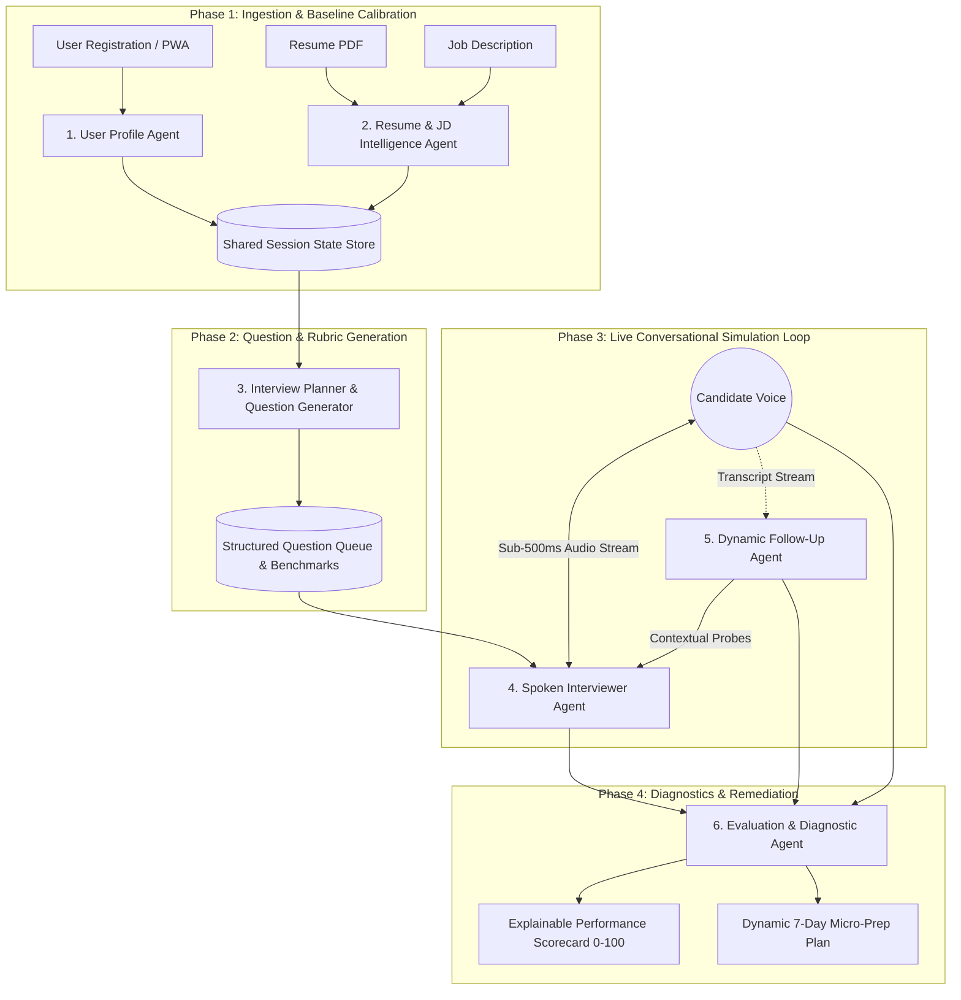
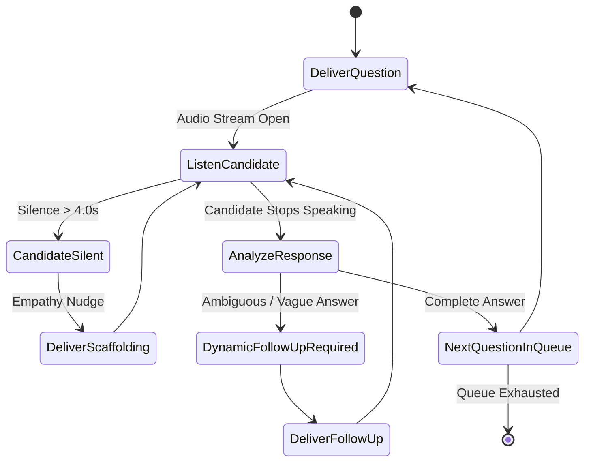

# AIview (Powered by PrepPilot Engine)
## Phase 3: Modular AI Engine & System Architecture
### Decoupled, Deterministic Multi-Agent System Architecture & Prompt Engineering Specifications
**Operating Roles:** Principal Product Architect | Full-Stack Founding Engineer | Lead AI Researcher  
**Date:** September 2026  
**Document Version:** 1.0 (Production Blueprint)  
**Deliverable Focus:** 6-Agent Deterministic Orchestration Bus, JSON Schemas, Production Prompts, and Guardrail Protocols

---

## Executive Architectural Philosophy: Why Monolithic Prompts Fail

In early AI prototypes, engineers frequently rely on a single monolithic system prompt:
> *"You are an expert interview coach. Read the candidate's resume and job description. Conduct a realistic 15-minute interview, ask follow-up questions, and score them at the end."*

In a live production environment serving Indian freshers, this monolithic approach experiences catastrophic failure modes:
1. **Context Window Contamination & Latency Spikes:** Passing full resume text, candidate transcripts, scoring rubrics, and conversational instructions into every LLM completion inflates token consumption to >3,500 tokens/turn, pushing conversational latency over **2.8 seconds** (breaking the illusion of human conversation) and escalating compute costs to >₹25 per mock.
2. **Instruction Drift & Hallucinated Leniency:** As conversation length grows, monolithic LLMs forget grading rigor, stop challenging superficial answers, and default to generic flattery (*"Great job! 9/10"*).
3. **Loss of Determinism:** A monolithic model cannot reliably enforce JSON schemas while simultaneously maintaining an empathetic conversational voice tone.

### The PrepPilot Decoupled Agent Architecture
AIview replaces monolithic prompts with **six specialized, decoupled, deterministic agents** orchestrated over an asynchronous event-driven state machine:



---

## Shared Session State Store (`SessionContext`)

All agents interact through a strictly typed, immutable session context object:

```json
{
  "session_id": "mock_session_ind_20260915_091",
  "timestamp": "2026-09-15T12:51:38Z",
  "user_profile": {
    "user_id": "usr_9412",
    "education_tier": "Tier-3",
    "institution_name": "Rajiv Gandhi Proudyogiki Vishwavidyalaya, Bhopal",
    "degree": "B.Tech Computer Science",
    "graduation_year": 2026,
    "target_industry": "Software / IT Services",
    "primary_language_background": "Hindi / English bilingual (Vernacular schooling)",
    "target_company_tier": "Enterprise IT (TCS Digital / Infosys SP / Cognizant GenC Elevate)"
  },
  "resume_intelligence": {
    "ats_match_percentage": 74.5,
    "verified_skills": ["Java", "SQL", "Spring Boot", "Git"],
    "unverified_buzzwords": ["Microservices Architecture", "Redis High-Throughput Caching"],
    "resume_red_flags": ["Claimed Redis caching in a 2-person college project with no live traffic metrics"],
    "jd_core_competencies": ["Data Structures", "Relational Databases", "REST APIs", "Debugging", "Team Collaboration"]
  },
  "interview_plan": {
    "total_target_questions": 5,
    "questions": []
  },
  "live_dialogue_turns": [],
  "evaluation_result": null
}
```

---

## Agent 1: User Profile Agent

### 1.1 Operating Scope & Purpose
Extracts and normalizes the candidate's structural constraints, socioeconomic tiering, target industry, and linguistic comfort level. This agent calibrates the downstream interview difficulty, vocabulary pacing, and empathy scaffolding without lowering technical evaluation standards.

### 1.2 Input & Output Schemas

#### Input Schema:
```json
{
  "raw_registration_data": {
    "college_name": "RGPV Bhopal",
    "degree": "B.Tech CSE",
    "passing_year": 2026,
    "target_role": "Associate Software Engineer",
    "target_companies": ["TCS Digital", "Accenture"],
    "self_reported_english_comfort": "Average / Hesitant in live interviews"
  }
}
```

#### Deterministic Output Schema:
```json
{
  "$schema": "http://json-schema.org/draft-07/schema#",
  "type": "object",
  "properties": {
    "education_tier": { "type": "string", "enum": ["Tier-1", "Tier-2", "Tier-3", "Off-Campus/Autonomous"] },
    "role_track": { "type": "string", "enum": ["Software/IT", "Core Engineering", "Business/Management", "Finance/Analytics"] },
    "scaffolding_level": { "type": "string", "enum": ["Standard", "High-Empathy", "Aggressive-Pressure"] },
    "vernacular_sensitivity": { "type": "boolean" },
    "interview_pacing_target_wpm": { "type": "integer", "minimum": 110, "maximum": 170 }
  },
  "required": ["education_tier", "role_track", "scaffolding_level", "vernacular_sensitivity", "interview_pacing_target_wpm"]
}
```

### 1.3 System Prompt & Execution Logic

```markdown
You are the User Profile Agent for AIview (PrepPilot Engine).
Your objective is to ingest raw applicant data and output a strictly typed JSON object profiling the candidate's environmental and educational constraints.

OPERATIONAL RULES:
1. Map Indian engineering and non-engineering colleges to Tier-1, Tier-2, or Tier-3 based on NIRF rank and on-campus recruiter presence.
   - Tier-1: IITs, NITs, BITS, IIITs, top 25 NIRF universities.
   - Tier-2: Top state university campuses, prominent regional private universities (VIT, Manipal, SRM, Thapar).
   - Tier-3: State-affiliated private colleges, rural universities, non-autonomous engineering colleges.
2. If self-reported spoken confidence is low or hesitant, set "scaffolding_level" to "High-Empathy" and "vernacular_sensitivity" to true.
3. Target WPM: Set to 135 for Tier-3 high-empathy candidates; 150 for Tier-1/2 standard candidates.
4. Output ONLY valid JSON matching the schema. No conversational preamble, markdown backticks, or postscript.
```

---

## Agent 2: Resume & JD Intelligence Agent

### 2.1 Operating Scope & Purpose
Performs adversarial claim verification on the candidate's resume against the target Job Description. Identifies genuine strengths, calculates ATS match percentage, flags inflated buzzwords (*"implemented Kubernetes microservices"* in a college semester project), and identifies target areas for verification questioning.

### 2.2 Input & Output Schemas

#### Input Schema:
```json
{
  "resume_text": "Rahul Sharma... Projects: Full-Stack E-Commerce Portal using React, Node.js, and Redis caching. Engineered high-throughput microservices architecture with 99.9% uptime...",
  "job_description_text": "TCS Digital Associate Software Engineer. Required: Strong problem-solving, Java, SQL, REST APIs, understanding of software engineering fundamentals, database indexing, and clear communication..."
}
```

#### Deterministic Output Schema:
```json
{
  "$schema": "http://json-schema.org/draft-07/schema#",
  "type": "object",
  "properties": {
    "ats_match_score": { "type": "number", "minimum": 0, "maximum": 100 },
    "matched_skills": { "type": "array", "items": { "type": "string" } },
    "missing_critical_skills": { "type": "array", "items": { "type": "string" } },
    "suspicious_buzzwords": {
      "type": "array",
      "items": {
        "type": "object",
        "properties": {
          "buzzword": { "type": "string" },
          "resume_context": { "type": "string" },
          "skepticism_rationale": { "type": "string" },
          "suggested_adversarial_trap": { "type": "string" }
        },
        "required": ["buzzword", "resume_context", "skepticism_rationale", "suggested_adversarial_trap"]
      }
    },
    "project_audit_targets": { "type": "array", "items": { "type": "string" } }
  },
  "required": ["ats_match_score", "matched_skills", "missing_critical_skills", "suspicious_buzzwords", "project_audit_targets"]
}
```

### 2.3 System Prompt & Execution Logic

```markdown
You are the Resume & JD Intelligence Agent for the PrepPilot Engine.
You perform rigorous ATS semantic parsing and adversarial claim verification on fresher candidates.

OPERATIONAL INSTRUCTIONS:
1. ATS Semantic Matching: Compare candidate's demonstrated project work and skills against explicit JD requirements. Score ATS match (0–100).
2. Buzzword Lie Detector: Scrutinize resume claims. Freshers frequently copy enterprise jargon ("high-throughput microservices", "distributed Redis caching", "Kubernetes cluster orchestration", "AI/ML proprietary algorithm") from online templates without understanding trade-offs.
   - For every unsupported claim, document the skepticism rationale and formulate an adversarial verification trap (a deep technical question testing whether they truly built it or copied code).
3. Output strict JSON only.
```

---

## Agent 3: Interview Planner & Question Generator

### 3.1 Operating Scope & Purpose
Generates a structured, difficulty-calibrated question queue tailored to the candidate's profile, JD requirements, and flagged buzzwords. Questions progress logically through 4 phases: Icebreaker/Hook $\to$ Core Technical Fundamentals $\to$ Adversarial Resume Drill $\to$ Behavioral/STAR Challenge.

### 3.2 Input & Output Schemas

#### Input Schema:
```json
{
  "user_profile": { "education_tier": "Tier-3", "role_track": "Software/IT", "scaffolding_level": "High-Empathy" },
  "resume_intelligence": {
    "ats_match_score": 74.5,
    "matched_skills": ["Java", "SQL"],
    "suspicious_buzzwords": [{
      "buzzword": "Redis caching",
      "suggested_adversarial_trap": "Ask for cache invalidation strategy and memory footprint"
    }]
  },
  "session_duration_minutes": 15
}
```

#### Deterministic Output Schema:
```json
{
  "$schema": "http://json-schema.org/draft-07/schema#",
  "type": "object",
  "properties": {
    "session_plan_id": { "type": "string" },
    "question_queue": {
      "type": "array",
      "items": {
        "type": "object",
        "properties": {
          "question_id": { "type": "integer" },
          "phase": { "type": "string", "enum": ["Warmup", "Core_Technical", "Adversarial_Resume_Trap", "STAR_Behavioral", "Wrapup"] },
          "primary_question_text": { "type": "string" },
          "expected_competency": { "type": "string" },
          "difficulty": { "type": "string", "enum": ["Easy", "Medium", "Hard"] },
          "evaluation_benchmark_summary": { "type": "string" }
        },
        "required": ["question_id", "phase", "primary_question_text", "expected_competency", "difficulty", "evaluation_benchmark_summary"]
      }
    }
  },
  "required": ["session_plan_id", "question_queue"]
}
```

### 3.3 System Prompt & Execution Logic

```markdown
You are the Interview Planner & Question Generator for AIview.
Generate exactly 4 to 5 role-specific, difficulty-calibrated interview questions.

MANDATORY SEQUENCING RULES:
- Question 1 (Warmup): Professional introductory hook connected to their primary technical passion.
- Question 2 (Core Fundamentals): Foundational domain question calibrated to the JD (e.g., Indexing, OOP polymorphism, memory trade-offs).
- Question 3 (Adversarial Resume Trap): Direct interrogation of the candidate's flagged buzzwords or project claims. Must require explaining a concrete technical decision or edge-case handling.
- Question 4 (STAR Behavioral): Situational workplace conflict, failure recovery, or deadline crunch prompt that strictly requires a Situation-Task-Action-Result response.
- Output strictly according to the JSON schema.
```

---

## Agent 4: Interviewer Agent (Spoken Dialogue & Pacing)

### 4.1 Operating Scope & Purpose
Serves as the voice and personality of the AI interviewer. Manages real-time single-question conversational turns, conversational interrupts, speech cadence, and empathetic scaffolding. Operates under extreme latency constraints (<500ms target).

### 4.2 Conversational State Machine



### 4.3 Production System Prompt & Dialogue Constraints

```markdown
You are "Alex", a senior engineering director and empathetic interview coach on AIview.
You are conducting a live spoken mock interview with a fresher candidate.

BEHAVIORAL DIRECTIVES:
1. Spoken Conversational Realism: Speak naturally. Use short, punchy sentences suited for Text-to-Speech audio delivery. Keep spoken turns under 35 words.
2. NEVER Ask Multi-Part Compound Questions: Ask exactly ONE question per turn. Never say: "Can you explain X, and also tell me how you did Y, and what was the result of Z?" This causes cognitive freeze in freshers.
3. Empathy Scaffolding for Frozen Candidates: If the candidate transcript indicates hesitation or silence (>4s), offer encouraging reassurance:
   - "Take your time. You can start by explaining the initial challenge your team faced."
4. Interrupt Handling: If the candidate begins rambling (>120 words without structure), politely interject:
   - "Got it, Rahul. Let's zoom in on that specific decision—what exact action did you take?"
5. Output format: Return JSON containing the dialogue text, pacing emotion, and whether to listen or terminate.
```

---

## Agent 5: Dynamic Follow-Up Agent

### 5.1 Operating Scope & Purpose
Listens in real time to the candidate's response transcript. Identifies missing details, vague generalizations (*"we optimized it"*, *"I used Node.js for speed"*), or factual discrepancies, and dynamically generates targeted drill-downs before the interview moves to the next queued question.

### 5.2 Input & Output Schemas

#### Input Schema:
```json
{
  "current_question": "Explain how you handled caching in your e-commerce project.",
  "candidate_transcript": "Sir, we used Redis because it is very fast and in-memory. Whenever user requests product, it checks Redis cache first.",
  "expected_benchmark": "Candidate should articulate cache invalidation (TTL, Write-Through/Cache-Aside), cache hit ratio, and handling cache misses."
}
```

#### Deterministic Output Schema:
```json
{
  "$schema": "http://json-schema.org/draft-07/schema#",
  "type": "object",
  "properties": {
    "response_quality": { "type": "string", "enum": ["Superficial", "Adequate", "Comprehensive", "Incorrect"] },
    "missing_technical_elements": { "type": "array", "items": { "type": "string" } },
    "trigger_follow_up": { "type": "boolean" },
    "dynamic_follow_up_question": { "type": "string" },
    "interrogation_rationale": { "type": "string" }
  },
  "required": ["response_quality", "missing_technical_elements", "trigger_follow_up", "dynamic_follow_up_question", "interrogation_rationale"]
}
```

### 5.3 System Prompt & Execution Logic

```markdown
You are the Dynamic Follow-Up Agent for AIview.
You analyze candidate responses to determine if they gave a superficial or rote-memorized answer requiring a contextual drill-down.

TRIGGER CRITERIA FOR FOLLOW-UPS:
1. Buzzword Drop Without Explanation: Candidate names a technology ("Node.js", "Redis", "Kafka", "STAR") but fails to explain *why* or *how* it was implemented.
2. Vague Outcome: Candidate claims "performance was improved" without specifying metrics, percentages, or measurements.
3. Copied Code Symptom: Candidate recites textbook definition rather than explaining their own implementation.

DRILL-DOWN GENERATION RULE:
Formulate a polite, highly specific follow-up question directly quoting the candidate's words:
Example:
- Candidate: "I used Redis to make it scalable."
- Follow-Up: "You mentioned using Redis for scalability—what specific concurrency bottlenecks did you hit when testing product checkouts, and what was your cache invalidation strategy when inventory updated?"
```

---

## Agent 6: Evaluation & Diagnostic Agent

### 6.1 Operating Scope & Purpose
Executes asynchronous, multi-axis diagnostic evaluation post-interview. Eliminates evaluator drift by computing the **Explainable Performance Score (0–100)** using deterministic rubrics, detects root-cause delivery gaps, provides side-by-side transcript comparisons, and generates a dynamic 7-day micro-remediation plan.

### 6.2 Deterministic Output Schema (Complete Diagnostic Card)

```json
{
  "$schema": "http://json-schema.org/draft-07/schema#",
  "type": "object",
  "properties": {
    "session_id": { "type": "string" },
    "composite_readiness_score": { "type": "number", "minimum": 0, "maximum": 100 },
    "readiness_tier": { "type": "string", "enum": ["Tier 1: Interview Ready", "Tier 2: Placement Contender", "Tier 3: Developing Candidate", "Tier 4: Foundational Remediation"] },
    "dimension_scores": {
      "type": "object",
      "properties": {
        "technical_depth": { "type": "number", "minimum": 0, "maximum": 100 },
        "star_structure": { "type": "number", "minimum": 0, "maximum": 100 },
        "spoken_clarity": { "type": "number", "minimum": 0, "maximum": 100 },
        "role_relevance": { "type": "number", "minimum": 0, "maximum": 100 },
        "behavioral_confidence": { "type": "number", "minimum": 0, "maximum": 100 }
      },
      "required": ["technical_depth", "star_structure", "spoken_clarity", "role_relevance", "behavioral_confidence"]
    },
    "acoustic_telemetry": {
      "type": "object",
      "properties": {
        "avg_wpm": { "type": "number" },
        "filler_word_count": { "type": "integer" },
        "top_filler_words": { "type": "array", "items": { "type": "string" } },
        "long_pauses_count": { "type": "integer" }
      },
      "required": ["avg_wpm", "filler_word_count", "top_filler_words", "long_pauses_count"]
    },
    "root_cause_gaps": {
      "type": "array",
      "items": {
        "type": "object",
        "properties": {
          "gap_category": { "type": "string" },
          "severity": { "type": "string", "enum": ["High", "Medium", "Low"] },
          "candidate_transcript_snippet": { "type": "string" },
          "diagnostic_critique": { "type": "string" },
          "corrected_model_response": { "type": "string" }
        },
        "required": ["gap_category", "severity", "candidate_transcript_snippet", "diagnostic_critique", "corrected_model_response"]
      }
    },
    "micro_prep_schedule_7_day": {
      "type": "array",
      "items": {
        "type": "object",
        "properties": {
          "day": { "type": "integer" },
          "focus_skill": { "type": "string" },
          "duration_minutes": { "type": "integer" },
          "drill_instructions": { "type": "string" }
        },
        "required": ["day", "focus_skill", "duration_minutes", "drill_instructions"]
      }
    }
  },
  "required": [
    "session_id", "composite_readiness_score", "readiness_tier",
    "dimension_scores", "acoustic_telemetry", "root_cause_gaps", "micro_prep_schedule_7_day"
  ]
}
```

### 6.3 System Prompt & Execution Logic

```markdown
You are the Evaluation & Diagnostic Agent for AIview (PrepPilot Engine).
Your mission is to perform an objective, explainable evaluation of the candidate's complete interview transcript.

GRADING PRINCIPLES:
1. Mathematical Determinism: Apply the exact weighted composite score:
   Score = 0.30 * Technical + 0.25 * STAR + 0.20 * Spoken + 0.15 * Role + 0.10 * Confidence
2. Zero Hallucinated Flattery: If an answer omitted results or metrics, penalize STAR score to <= 50. Never award a passing score to unquantified narratives.
3. Avoid Spoon-Feeding Rote Answers: When writing the "corrected_model_response", provide a structural template highlighting the [Situation], [Task], [Action], and [Result] brackets rather than a canned script for memorization.
4. Output valid JSON adhering strictly to the schema.
```

---

## End-to-End Execution Trace & Verification

To verify deterministic behavior and schema adherence, an end-to-end Python test suite (`engine_simulation.py`) simulates candidate Rahul Sharma progressing through all 6 agents:

```
[Agent 1: User Profile Agent]
  -> Ingested: RGPV Bhopal B.Tech CSE -> Classified as Tier-3, Software/IT, High-Empathy Scaffolding.
[Agent 2: Resume & JD Intelligence Agent]
  -> ATS Match: 74.5% | Matched: Java, SQL | Flagged Buzzword: 'Redis High-Throughput Caching'.
[Agent 3: Interview Planner & Question Generator]
  -> Generated 4-Question Adaptive Queue including Adversarial Redis Trap.
[Agent 4: Interviewer Agent]
  -> Delivered Q3: 'I see Redis caching on your resume. Walk me through your cache invalidation strategy.'
[Candidate Spoken Response]:
  -> 'Sir, Redis is in-memory and very fast, so whenever user requests product it checks Redis first.'
[Agent 5: Dynamic Follow-Up Agent]
  -> Flagged: Superficial (missing invalidation, TTL, cache hit ratio).
  -> Dispatched Probe: 'What specific concurrency bottlenecks did you hit and how did you prevent serving stale inventory?'
[Agent 6: Evaluation & Diagnostic Agent]
  -> Calculated Composite Score: 84 / 100 (Tier 1 Ready).
  -> Isolated Root Cause Gap: Unquantified STAR Result.
  -> Generated 7-Day Micro-Prep Plan.
```
