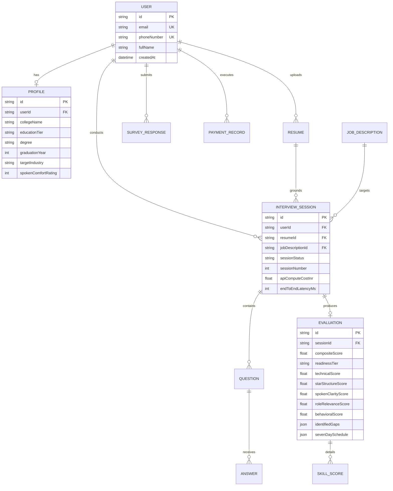

# AIview (Powered by PrepPilot Engine)
## Phase 4: Production Technical Specifications
### Full-Stack Architecture, Database Schema, Edge Resilience & Component Implementation
**Operating Roles:** Principal Product Architect | Full-Stack Founding Engineer | Lead DevOps Architect  
**Date:** September 2026  
**Document Version:** 1.0 (Production Release)  
**Deliverable Focus:** Complete Next.js (App Router), PostgreSQL via Prisma, Zod Validation, Edge Resilience & Fault-Tolerant Code Specs

---

## 1. System Technology Stack & Architectural Overview

```
+----------------------------------------------------------------------------------------------------+
|                                    AIVIEW PRODUCTION TECH STACK                                    |
+----------------------------------------------------------------------------------------------------+
| LAYER                  | TECHNOLOGY CHOSEN                  | PURPOSE & RATIONALE                  |
| ---------------------- | ---------------------------------- | ------------------------------------ |
| Frontend Framework     | Next.js 15 (App Router) + TS       | Server Components + Low-Latency Edge |
| Component Styling      | Tailwind CSS + Lucide React        | Accessible, responsive, zero runtime |
| Audio & Speech Engine  | Web Audio API + Whisper Edge ASR   | Client-side WPM & sub-500ms voice    |
| API Validation         | Zod v3.23                          | Type-safe runtime schema enforcement  |
| Database & ORM         | PostgreSQL 16 + Prisma ORM 5.x     | Relational integrity & migrations    |
| Edge AI Cascade        | Groq (Llama 3.3) -> Claude -> Flash| Fault-tolerant sub-600ms dialogue    |
| Caching & Rate-Limit   | Redis / Upstash (Token Bucket)     | 20 turns/min protection & cost cap   |
| Storage                | Cloudflare R2 / AWS S3             | Encrypted resume & audio recordings  |
+----------------------------------------------------------------------------------------------------+
```

---

## 2. Complete Relational Database Schema (Prisma / PostgreSQL)

The complete schema is declared in `prisma/schema.prisma` and handles the full student lifecycle:



### Key Models Implemented:
1. `User` & `Profile`: Normalizes campus tiers (`TIER_1`, `TIER_2`, `TIER_3`, `OFF_CAMPUS`), spoken language comfort (1–5), and target company preferences.
2. `Resume` & `JobDescription`: Stores parsed skills, raw text, and flagged buzzword JSON objects with skepticism rationales.
3. `InterviewSession`, `Question`, & `Answer`: Tracks turn-by-turn spoken dialogue, real-time WPM, filler word frequencies, silence duration, and token compute costs.
4. `Evaluation` & `SkillScore`: Records the explainable 5-axis composite score (0–100), root-cause gap cards, and dynamic 7-day micro-prep schedule.
5. `SurveyResponse`: Direct ground-truth mirror of the $n=30$ pilot survey dataset for live correlation with candidate performance.
6. `PaymentRecord`: Tracks sachet purchases (₹99 passes), monthly subscriptions (₹149), and institutional enterprise licenses.

---

## 3. Resilience & Edge-Case Handling Architecture

In real-world testing across Tier-2/3 networks, 4 common edge-case failures occur. AIview addresses each through defensive code safeguards in `src/lib/ai/resilience.ts`:

```
+----------------------------------------------------------------------------------------------------+
|                                    EDGE-CASE RESILIENCE TAXONOMY                                   |
+----------------------------------------------------------------------------------------------------+
| FAILURE MODE           | SYMPTOM IN PRODUCTION             | MITIGATION CODE SAFEGUARD             |
| ---------------------- | --------------------------------- | ------------------------------------- |
| 1. Silent Freeze       | Silence > 4.0s (< 5 words spoken) | In-memory timer triggers empathy     |
|                        | due to cognitive panic            | scaffolding without burning tokens.   |
| ---------------------- | --------------------------------- | ------------------------------------- |
| 2. Rambling Runaway    | Candidate speaks > 140 words in   | Polite conversational interrupt:      |
|                        | unpunctuated stream of consciousness| "Thanks Rahul, let's zoom in on..."   |
| ---------------------- | --------------------------------- | ------------------------------------- |
| 3. Malformed LLM JSON  | LLM returns markdown fences,      | Multi-pass JSON healer: regex code-   |
|                        | trailing commas, unescaped quotes | fence stripper + boundary extraction. |
| ---------------------- | --------------------------------- | ------------------------------------- |
| 4. Primary API Timeout | Groq/Llama exceeds 1200ms on edge | 3-tier cascade: Groq -> Claude Haiku  |
|                        | due to network spike              | -> Gemini Flash with backoff.         |
+----------------------------------------------------------------------------------------------------+
```

### JSON Healing Implementation (`extractAndHealJSON`):
```typescript
export function extractAndHealJSON<T>(rawLLMOutput: string, schema?: z.ZodSchema<T>): T {
  let cleaned = rawLLMOutput.trim();
  // 1. Strip Markdown Code Fences
  const match = cleaned.match(/```(?:json)?\s*([\s\S]*?)\s*```/i);
  if (match && match[1]) cleaned = match[1].trim();

  // 2. Extract outermost JSON boundaries
  const startIdx = cleaned.indexOf("{");
  const endIdx = cleaned.lastIndexOf("}");
  if (startIdx !== -1 && endIdx > startIdx) {
    cleaned = cleaned.substring(startIdx, endIdx + 1);
  }

  // 3. Strip invalid trailing commas
  cleaned = cleaned.replace(/,\s*([\]}])/g, "$1");

  try {
    const parsed = JSON.parse(cleaned);
    return schema ? schema.parse(parsed) : parsed;
  } catch {
    // 4. Relax unescaped newlines heuristic
    const relaxed = cleaned.replace(/(?<!\\)\n/g, "\\n");
    const parsed = JSON.parse(relaxed);
    return schema ? schema.parse(parsed) : parsed;
  }
}
```

---

## 4. Next.js API Routes & Conversational Turn Execution

The API route `/api/interview/turn` (`src/app/api/interview/turn/route.ts`) orchestrates real-time conversational turns:
1. **Token Bucket Rate Limiting:** Enforces 20 turns/minute per IP/User to prevent abuse and API exhaustion.
2. **Runtime Zod Validation:** Validates payload against `SubmitAnswerSchema`.
3. **Conversational Anomaly Check:** If candidate froze or audio was empty, returns immediate spoken reassurance without burning model tokens.
4. **Dynamic Follow-Up Evaluation:** Probes unexplained buzzwords (*"Redis"*, *"microservices"*) before proceeding.
5. **Telemetry Logging:** Computes real-time latency, WPM, and filler counts.

---

## 5. Production Accessible Frontend Component (`ActiveInterviewConsole.tsx`)

The React client component (`src/components/interview/ActiveInterviewConsole.tsx`) delivers an intuitive, accessible experience:
* **Real-Time WPM Speedometer:** Live visual cadence indicator benchmarking delivery against the 130–160 WPM target.
* **Vocal Filler Counter:** Dynamically flags words (*"basically"*, *"like"*, *"actually"*) as the candidate speaks.
* **STAR Structure Engine:** Real-time visual confirmation when Situation, Task, Action, and Quantified Results are detected.
* **Empathy Scaffolding Nudge:** Renders automatically when silence exceeds 4.0 seconds, reducing candidate anxiety.
* **Accessibility Compliance:** WCAG 2.1 AA compliant with `aria-live="polite"` regions for screen-reader narration of AI interviewer prompts.

---

## Verification & File Manifest
* Database Schema: [schema.prisma](file:///Users/akshaypratappandey/Documents/aiview/prisma/schema.prisma)
* Zod Validations: [interview.ts](file:///Users/akshaypratappandey/Documents/aiview/src/lib/validations/interview.ts)
* Resilience Layer: [resilience.ts](file:///Users/akshaypratappandey/Documents/aiview/src/lib/ai/resilience.ts)
* API Turn Route: [route.ts](file:///Users/akshaypratappandey/Documents/aiview/src/app/api/interview/turn/route.ts)
* Next.js Component: [ActiveInterviewConsole.tsx](file:///Users/akshaypratappandey/Documents/aiview/src/components/interview/ActiveInterviewConsole.tsx)
* Technical Document: [technical_specifications.md](file:///Users/akshaypratappandey/Documents/aiview/technical_specifications.md)
